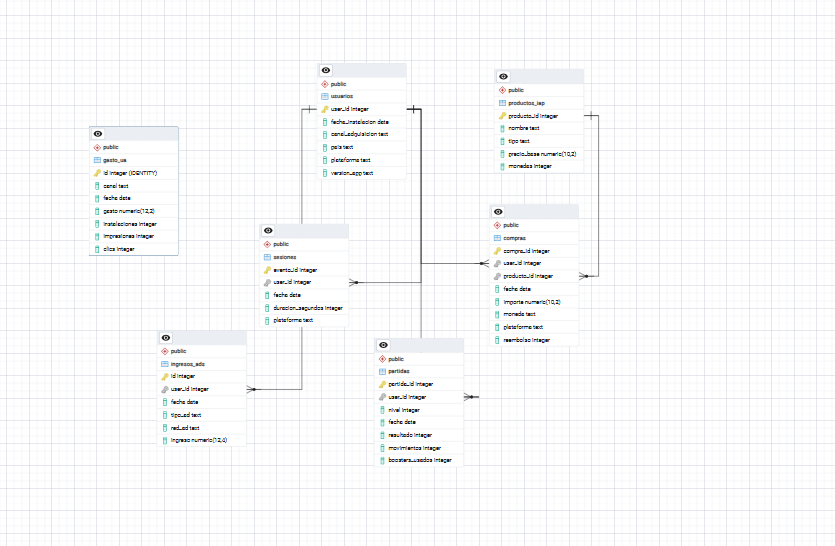

# PlayLoop — Análisis de rendimiento de captación (UA)

Caso "Mundo Real" de BigDataStack. Estudio de datos aplicado a un caso de negocio simulado de la industria del gaming móvil (F2P).

## Contexto del negocio

PlayLoop Studio (Barcelona, F2P, juego principal *Match Valley*) es rentable pero está estancado en descargas orgánicas. Su modelo se basa en dos vías de ingreso:

- **IAP (in-app purchases)**: solo ~1,3% de los jugadores paga alguna vez.
- **Publicidad**: el 98,7% restante genera ingresos viendo anuncios.

Cada instalación cuesta dinero (CPI, coste por instalación) y ese coste solo se recupera si el jugador, a lo largo de su vida en el juego (LTV), genera más valor del que costó traerlo. Por eso el análisis no se mira jugador a jugador, sino por **cohortes** (grupos de jugadores instalados en el mismo periodo).

## Encargo

> El mes pasado Crecimiento probó un canal nuevo, **CoinRush**. Bruno (Growth/UA) quiere subirle el 60% del presupuesto del próximo trimestre. Antes de mover ese dinero, Nerea pide algo sencillo de decir y difícil de hacer bien: ¿de verdad nos está funcionando la captación del último mes, y dónde conviene poner el presupuesto?

## Resultado y entrega ejecutiva

CoinRush concentra el 35% de los jugadores y tiene un CPI de 0,45 €, pero su ROAS neto observado es 0,27: aproximadamente 270 € registrados por cada 1.000 € invertidos hasta la extracción. La recomendación provisional es no aprobar el aumento de presupuesto antes de validar gastos y comparar cohortes de edad equivalente.

Consultar el **[informe ejecutivo](docs/informe_ejecutivo.md)**, con la comparación por canal, la recomendación y sus límites. Gráficos: [retención](docs/img/retencion_por_canal.png), [conversión](docs/img/conversion_por_canal.png) y [ROAS](docs/img/roas_por_canal.png).

## Encuadre — preguntas medibles

Antes de explorar los datos, la pregunta vaga se convierte en preguntas calculables:

1. ¿Cuál es el CPI de CoinRush frente a los demás canales, en el mismo periodo?
2. Comparando cohortes de la misma "edad" desde instalación, ¿qué retención (D1/D7) y qué tasa de pago tienen los jugadores de CoinRush frente a otros canales?
3. ¿Cuánto ingreso neto genera de media un jugador de CoinRush hasta ahora (IAP neto de comisión de tienda + ingresos por ads), y qué ROAS (LTV/CPI) da eso?
4. Dado que CoinRush solo lleva un mes activo, ¿hay ya datos suficientes para fiarnos de ese ROAS, o solo se pueden comparar señales tempranas (retención) porque el LTV aún no ha madurado?

## Datos disponibles

| Tabla | Granularidad | Clave | Contenido |
|---|---|---|---|
| `usuarios.csv` | 1 fila por jugador | `user_id` (PK) | canal de adquisición, país, plataforma, fecha de instalación |
| `sesiones.csv` | 1 fila por apertura de la app | `user_id` (FK) | fecha, duración |
| `partidas.csv` | 1 fila por nivel jugado | `user_id` (FK) | nivel, resultado, movimientos |
| `compras.csv` | 1 fila por transacción | `user_id`, `producto_id` (FK) | importe, moneda, plataforma, reembolso |
| `productos_iap.csv` | 1 fila por producto | `producto_id` (PK) | tipo, precio base |
| `ingresos_ads.csv` | 1 fila por impresión de anuncio | `user_id` (FK) | tipo de anuncio, red, ingreso |
| `gasto_ua.csv` | 1 fila por canal y día | — (no tiene `user_id`) | gasto, instalaciones, impresiones, clics — aquí sale el CPI |

`gasto_ua` es la única tabla que se cruza por canal y no por jugador, porque el gasto de publicidad viene agregado de la red de anuncios.

## Modelo de datos en PostgreSQL



`usuarios` se relaciona con `sesiones`, `partidas`, `compras` e `ingresos_ads` mediante `user_id`. Las compras también se relacionan con `productos_iap` mediante `producto_id`.

La captura muestra seis tablas. `gasto_ua` es la séptima: permanece independiente, sin claves foráneas, y no aparece en esta imagen.

El archivo [`sql/schema.sql`](sql/schema.sql) contiene la creación de las siete tablas, sus tipos de datos y sus restricciones.

## Estructura del proyecto

```text
playloop-game-industry/
├── data/
│ ├── raw/ # CSV originales, sin tocar 
│ └── processed/ # datos limpios, listos para calcular
├── notebooks/ # exploración, limpieza, cálculo de KPIs
├── sql/
│ └── schema.sql # creación de las siete tablas en PostgreSQL
├── docs/ # resumen ejecutivo, gráficos exportados
│ └── img/
│     └── schema.png # diagrama de relaciones
└── README.md
```


## Metodología

1. **Encuadrar** — convertir la pregunta vaga en preguntas medibles 
2. **Explorar** — abrir los ficheros y ver qué hay, sin arreglar nada todavía
3. **Limpiar** — dejar los datos en un estado fiable
4. **Calcular** — sacar las métricas que responden al encuadre
5. **Comunicar** — convertir el número en algo que cambie una decisión
