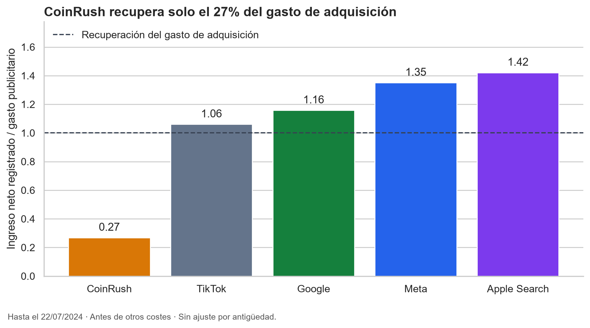

# PlayLoop — Captación, retención y retorno por canal

Proyecto de portfolio basado en el [caso simulado de BigDataStack](https://bigdatastack.dev/profesion/analisis-datos/mundo-real/playloop), ampliado con exploración detallada, limpieza documentada, análisis SQL y visualizaciones en Python.

**Tecnologías:** Python · pandas · PostgreSQL · SQLAlchemy · matplotlib · seaborn.

## Pregunta de negocio

PlayLoop monetiza un juego móvil mediante compras dentro de la aplicación y anuncios. El equipo propone aumentar un 60% el presupuesto de CoinRush, un canal con muchas instalaciones y bajo coste. **¿Justifican sus resultados esa inversión?**

## Resultados principales

| Indicador de CoinRush | Resultado |
|---|---:|
| Jugadores captados | 2.800 de 8.000 (35%) |
| Coste por instalación (CPI) | 0,45 € |
| Retención D7 | 2,4% |
| Conversión a pagador | 0,11% |
| Ingreso neto observado por jugador | 0,121 € |
| ROAS neto observado | 0,27 |
| Ingreso neto menos adquisición | −921,68 € |

**Por cada 1.000 € invertidos en CoinRush, se han registrado aproximadamente 270 € netos hasta la extracción.** Su captación barata no se traduce en recuperación del gasto. La baja retención D7 aparece en los cuatro países analizados.

**Recomendación provisional:** no aprobar el aumento antes de validar los gastos elevados y comparar cohortes de edad equivalente.



**Entregas:** [informe ejecutivo](docs/informe_ejecutivo.md) · [retención por canal](docs/img/retencion_por_canal.png) · [conversión a pagador](docs/img/conversion_por_canal.png).

## Datos y modelo

Siete CSV: `usuarios`, `sesiones`, `partidas`, `compras`, `productos_iap`, `ingresos_ads` y `gasto_ua`. Las sesiones observadas abarcan del 28/05 al 22/07/2024.

La actividad se relaciona con usuarios por `user_id`; las compras también con productos por `producto_id`. El gasto está agregado por canal y fecha: no se relaciona por jugador ni permite atribuir directamente costes a países o plataformas.


La captura muestra seis tablas; `gasto_ua` permanece independiente. La creación de las siete tablas está en [sql/schema.sql](sql/schema.sql).

## Trabajo realizado

Exploración de calidad, normalización de categorías y fechas, eliminación de duplicados, validación de relaciones y exportación de datos limpios. Las métricas se calcularon en SQL y los gráficos se reprodujeron con pandas desde los CSV.

- **Compras:** excluidos 67 reembolsos y 12 operaciones en MXN; quedan 4.479 ventas válidas en euros.
- **Sesiones:** excluidas 60 duraciones fuera de 1–3.600 segundos y 312 duplicados; quedan 44.573 sesiones.
- **Datos desconocidos:** conservados como nulos. Fechas corregidas con formatos explícitos. [Detalle de la corrección](docs/correccion_fechas.md).

## Estructura

```text
data/raw/                          CSV originales
data/processed/                    CSV limpios
notebooks/01_exploracion.ipynb      Diagnóstico de las siete tablas
notebooks/02_limpieza.ipynb         Transformaciones y comprobaciones
notebooks/03_analisis.ipynb         Actividad, monetización y canales en SQL
notebooks/04_visualizaciones.ipynb  Gráficos desde CSV con pandas
sql/schema.sql                     Tablas y relaciones de PostgreSQL
scripts/carga_postgres.py           Carga de los CSV limpios
docs/informe_ejecutivo.md           Hallazgos, recomendación y límites
docs/img/                          Gráficos y diagrama del modelo
```

## Reproducción breve

1. Crear un entorno Python e instalar dependencias: `pip install -r requirements.txt`.
2. Ejecutar `01_exploracion.ipynb` y `02_limpieza.ipynb` desde `notebooks/`.
3. Crear una base PostgreSQL llamada `playloop` y ejecutar `sql/schema.sql`.
4. Crear `.env` en la raíz con `DB_HOST`, `DB_PORT`, `DB_NAME`, `DB_USER` y `DB_PASSWORD`. Está excluido de Git.
5. Desde la raíz, ejecutar `python scripts/carga_postgres.py` y después `03_analisis.ipynb`. La carga omite las tablas que ya contienen datos.
6. Ejecutar `04_visualizaciones.ipynb` para generar las imágenes; solo necesita los CSV limpios, sin PostgreSQL.

## Alcance y límites

El ROAS utiliza compras netas de una comisión asumida del 30% más anuncios registrados, dividido entre adquisición. **Un ROAS de 1 recupera ese gasto; no representa beneficio final.** El valor acumulado al corte no equivale al LTV completo.

La retención usa cohortes elegibles para cada plazo; conversión y retorno todavía no están ajustados a igual antigüedad. Hay 600 ingresos publicitarios desconocidos y tres gastos superiores a 1.000 € pendientes de validar. El proyecto reproduce un caso educativo: la recomendación no implica una decisión tomada en una empresa real.
