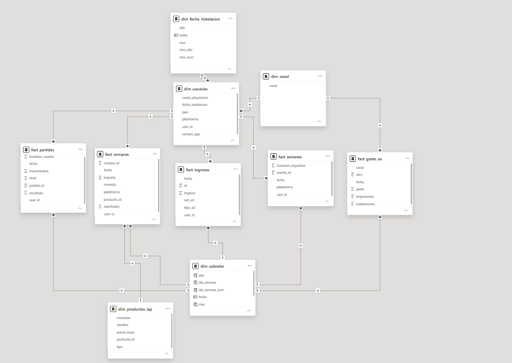

# PlayLoop — Informe en Power BI

**Archivo:** [powerbi/PlayLoop_Analytics.pbix](../powerbi/PlayLoop_Analytics.pbix). Fuente: los siete CSV de `data/processed/`. Corte de observación: 22/07/2024.

## Páginas

| Página | Contenido |
|---|---|
| Captación y retorno | Jugadores, gasto, ingreso neto y ROAS de pago; barras de retorno, CPI frente a ingreso observado, desglose de ingresos y saldo por canal; destacado de CoinRush. |
| Retención y monetización | Tarjetas D1/D7/D30 y conversión; líneas de retención, barras de conversión, tabla de elegibles y retenidos; media, mediana y máximo del gasto por pagador. |

## Modelo

`dim_usuarios` filtra `fact_sesiones`, `fact_partidas`, `fact_compras` y `fact_ingresos` por `user_id`. `dim_productos_iap` filtra las compras por `producto_id`. `dim_canal` filtra usuarios y `fact_gasto_ua`, evitando unir directamente hechos de distinta granularidad.

El calendario de actividad filtra las fechas de los hechos. `dim_fecha_instalacion` filtra usuarios por fecha de instalación y permite explorar cohortes sin restringir su actividad al día en que instalaron. Las relaciones se configuraron como uno a varios, activas y con filtro único desde dimensiones a hechos.

La tabla auxiliar `plazos_retencion` no tiene relaciones: sus valores D1/D7/D30 permiten seleccionar las medidas correspondientes mediante `SWITCH` y construir el gráfico y la tabla de cohortes.

## Definiciones y comprobaciones

| Indicador | Definición | Total sin filtros |
|---|---|---:|
| Jugadores | Usuarios distintos | 8.000 |
| Pagadores | Usuarios distintos con compras válidas | 107 |
| Conversión | Pagadores / jugadores | 1,34% |
| Compras brutas | Suma de importes válidos | 10.838,71 € |
| Compras netas | Bruto × 0,70 | 7.587,10 € |
| Anuncios | Suma del ingreso informado | 3.997,99 € |
| Ingreso neto registrado | Compras netas + anuncios | 11.585,09 € |
| Gasto de adquisición | Suma de gasto | 9.060,01 € |
| ROAS de pago | Ingresos de canales con gasto / gasto de esos canales | 1,14 |
| D1 | 3.261 retenidos / 8.000 elegibles | 40,8% |
| D7 | 1.005 retenidos / 6.808 elegibles | 14,8% |
| D30 | 176 retenidos / 2.470 elegibles | 7,1% |
| Gasto por pagador | Suma de compras por persona: media / mediana / máximo | 101,3 € / 29,4 € / 2.658,53 € |

El CPI divide gasto entre jugadores del canal. El valor observado divide ingreso neto registrado entre esos jugadores. El saldo tras adquisición resta gasto al ingreso neto. Un ROAS de 1 cubre adquisición, no todos los costes. El orgánico tiene ROAS vacío por gasto cero; el ratio global que incluye sus ingresos (1,28) es distinto del ROAS de pago (1,14).

Cada retención cuenta actividad exactamente N días después de instalar y solo usuarios que pudieron alcanzar ese plazo al corte fijo. Las medidas se contrastaron con los resultados SQL sin filtros. La media y la mediana utilizan gasto acumulado por pagador, no importes individuales de compra.

## Filtros e interpretación

- **Canal:** utilizar `dim_canal[canal]` para filtrar usuarios y gasto conjuntamente.
- **País y plataforma:** utilizar los atributos de `dim_usuarios` en la página de comportamiento. El gasto no tiene ese desglose, por lo que estos filtros no permiten calcular un coste atribuible por país o plataforma.
- **Instalación:** utilizar `dim_fecha_instalacion[fecha]`. Selecciona jugadores, pero no asigna automáticamente el gasto a esa cohorte.
- **Actividad:** no aplicar un segmentador del calendario de actividad a la página de retención sin adaptar las medidas: podría recortar sesiones necesarias para D7/D30.
- **Textos fijos:** la cifra de 270 € de CoinRush y la concentración global de tres pagadores (52,7%) corresponden al análisis sin filtros. Si se presentan como anotaciones fijas, deben identificarse como globales y no interpretarse como resultados recalculados.
- **Porcentajes de pagadores o gasto:** las medidas con `ALLSELECTED` expresan participación dentro de la selección actual, no necesariamente sobre todo el dataset.

La conversión y el retorno acumulado no ajustan todavía a igual edad de cohorte. Se mantienen los 600 ingresos publicitarios desconocidos y los tres gastos elevados pendientes de validación. El dashboard no elimina estas limitaciones del [informe ejecutivo](informe_ejecutivo.md).

## Abrir y actualizar

1. Abrir el `.pbix` en Power BI Desktop.
2. Para actualizar, entrar en Power Query y ajustar los pasos de origen de los CSV a la carpeta local `data/processed/`.
3. Conservar el punto decimal del CSV mediante configuración regional adecuada; los identificadores son enteros y las fechas, tipo fecha.
4. Actualizar y contrastar los totales de la tabla anterior, sin filtros ni selecciones en gráficos.

El archivo contiene el modelo importado. No necesita PostgreSQL para visualizar sus datos guardados; la actualización depende de los CSV locales. No se ha publicado en Power BI Service.
